<!-- Banner: ASCII manta + eagle ray in the Lagoon palette, under a liquid-glass card. -->

Building [Soltrix](https://thesoltrix.com).

<!-- STACK:start -->
<table>
<tr><td>
<b>languages</b> 
<picture><source media="(prefers-color-scheme: dark)" srcset="https://img.shields.io/badge/TypeScript-21262D?style=flat&logo=typescript&logoColor=3178C6"></picture>
<picture><source media="(prefers-color-scheme: dark)" srcset="https://img.shields.io/badge/Swift-21262D?style=flat&logo=swift&logoColor=F05138"></picture>
<picture><source media="(prefers-color-scheme: dark)" srcset="https://img.shields.io/badge/Python-21262D?style=flat&logo=python&logoColor=FFD43B"></picture>
<picture><source media="(prefers-color-scheme: dark)" srcset="https://img.shields.io/badge/JavaScript-21262D?style=flat&logo=javascript&logoColor=F7DF1E"></picture>
<picture><source media="(prefers-color-scheme: dark)" srcset="https://img.shields.io/badge/Rust-21262D?style=flat&logo=rust&logoColor=DEA584"></picture>
<picture><source media="(prefers-color-scheme: dark)" srcset="https://img.shields.io/badge/HTML-21262D?style=flat&logo=html5&logoColor=E34F26"></picture>
<picture><source media="(prefers-color-scheme: dark)" srcset="https://img.shields.io/badge/CSS-21262D?style=flat&logo=css&logoColor=A87BD8"></picture>
<picture><source media="(prefers-color-scheme: dark)" srcset="https://img.shields.io/badge/SQL-21262D?style=flat&logo=postgresql&logoColor=6CA0DC"></picture>
<picture><source media="(prefers-color-scheme: dark)" srcset="https://img.shields.io/badge/Shell-21262D?style=flat&logo=gnubash&logoColor=89E051"></picture>
</td></tr>
<tr><td>
<b>frontend</b> 
<picture><source media="(prefers-color-scheme: dark)" srcset="https://img.shields.io/badge/React-21262D?style=flat&logo=react&logoColor=61DAFB"></picture>
<picture><source media="(prefers-color-scheme: dark)" srcset="https://img.shields.io/badge/Next.js-21262D?style=flat&logo=nextdotjs&logoColor=FFFFFF"></picture>
<picture><source media="(prefers-color-scheme: dark)" srcset="https://img.shields.io/badge/Tailwind-21262D?style=flat&logo=tailwindcss&logoColor=38BDF8"></picture>
<picture><source media="(prefers-color-scheme: dark)" srcset="https://img.shields.io/badge/Framer_Motion-21262D?style=flat&logo=framer&logoColor=4D8BFF"></picture>
<picture><source media="(prefers-color-scheme: dark)" srcset="https://img.shields.io/badge/Vite-21262D?style=flat&logo=vite&logoColor=9499FF"></picture>
<picture><source media="(prefers-color-scheme: dark)" srcset="https://img.shields.io/badge/Tauri-21262D?style=flat&logo=tauri&logoColor=24C8D8"></picture>
<picture><source media="(prefers-color-scheme: dark)" srcset="https://img.shields.io/badge/SwiftUI-21262D?style=flat&logo=apple&logoColor=FFFFFF"></picture>
</td></tr>
<tr><td>
<b>ai / ml</b> 
<picture><source media="(prefers-color-scheme: dark)" srcset="https://img.shields.io/badge/OpenAI-21262D?style=flat"></picture>
<picture><source media="(prefers-color-scheme: dark)" srcset="https://img.shields.io/badge/PyTorch-21262D?style=flat&logo=pytorch&logoColor=EE4C2C"></picture>
<picture><source media="(prefers-color-scheme: dark)" srcset="https://img.shields.io/badge/Hugging_Face-21262D?style=flat&logo=huggingface&logoColor=FFD21E"></picture>
<picture><source media="(prefers-color-scheme: dark)" srcset="https://img.shields.io/badge/scikit--learn-21262D?style=flat&logo=scikitlearn&logoColor=F7931E"></picture>
<picture><source media="(prefers-color-scheme: dark)" srcset="https://img.shields.io/badge/pandas-21262D?style=flat&logo=pandas&logoColor=E70488"></picture>
<picture><source media="(prefers-color-scheme: dark)" srcset="https://img.shields.io/badge/NumPy-21262D?style=flat&logo=numpy&logoColor=4DABCF"></picture>
<picture><source media="(prefers-color-scheme: dark)" srcset="https://img.shields.io/badge/Claude_Code-21262D?style=flat&logo=claude&logoColor=D97757"></picture>
</td></tr>
<tr><td>
<b>infra</b> 
<picture><source media="(prefers-color-scheme: dark)" srcset="https://img.shields.io/badge/Cloudflare_Workers-21262D?style=flat&logo=cloudflare&logoColor=F38020"></picture>
<picture><source media="(prefers-color-scheme: dark)" srcset="https://img.shields.io/badge/Supabase-21262D?style=flat&logo=supabase&logoColor=3ECF8E"></picture>
<picture><source media="(prefers-color-scheme: dark)" srcset="https://img.shields.io/badge/FastAPI-21262D?style=flat&logo=fastapi&logoColor=05998B"></picture>
<picture><source media="(prefers-color-scheme: dark)" srcset="https://img.shields.io/badge/Docker-21262D?style=flat&logo=docker&logoColor=2496ED"></picture>
<picture><source media="(prefers-color-scheme: dark)" srcset="https://img.shields.io/badge/GitHub_Actions-21262D?style=flat&logo=githubactions&logoColor=4C9AFF"></picture>
<picture><source media="(prefers-color-scheme: dark)" srcset="https://img.shields.io/badge/SQLite-21262D?style=flat&logo=sqlite&logoColor=4FA8DA"></picture>
<picture><source media="(prefers-color-scheme: dark)" srcset="https://img.shields.io/badge/PostHog-21262D?style=flat&logo=posthog&logoColor=F9BD2B"></picture>
<picture><source media="(prefers-color-scheme: dark)" srcset="https://img.shields.io/badge/Stripe-21262D?style=flat&logo=stripe&logoColor=8C86FF"></picture>
</td></tr>
</table>
<!-- STACK:end -->
